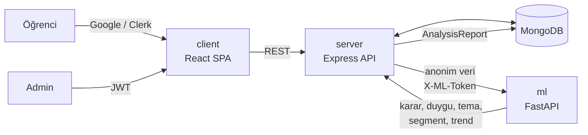
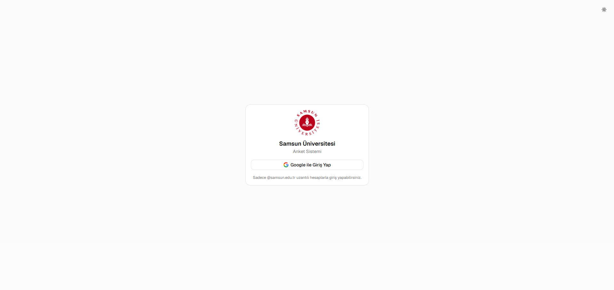
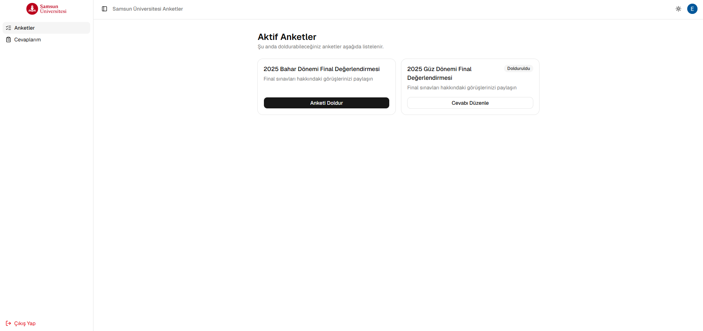
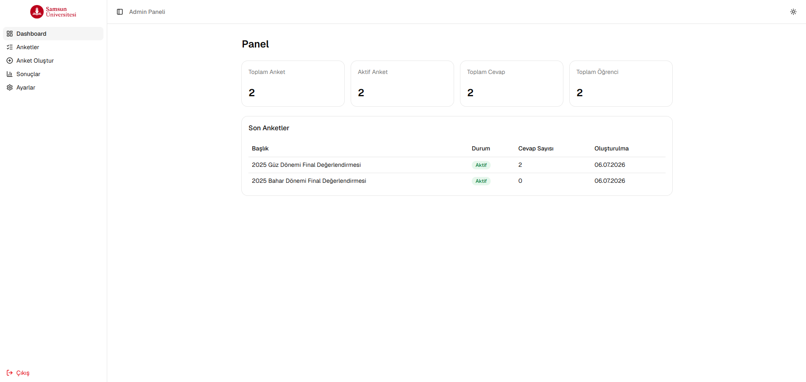
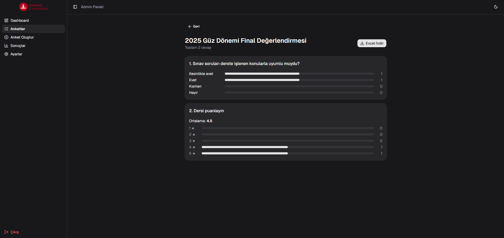
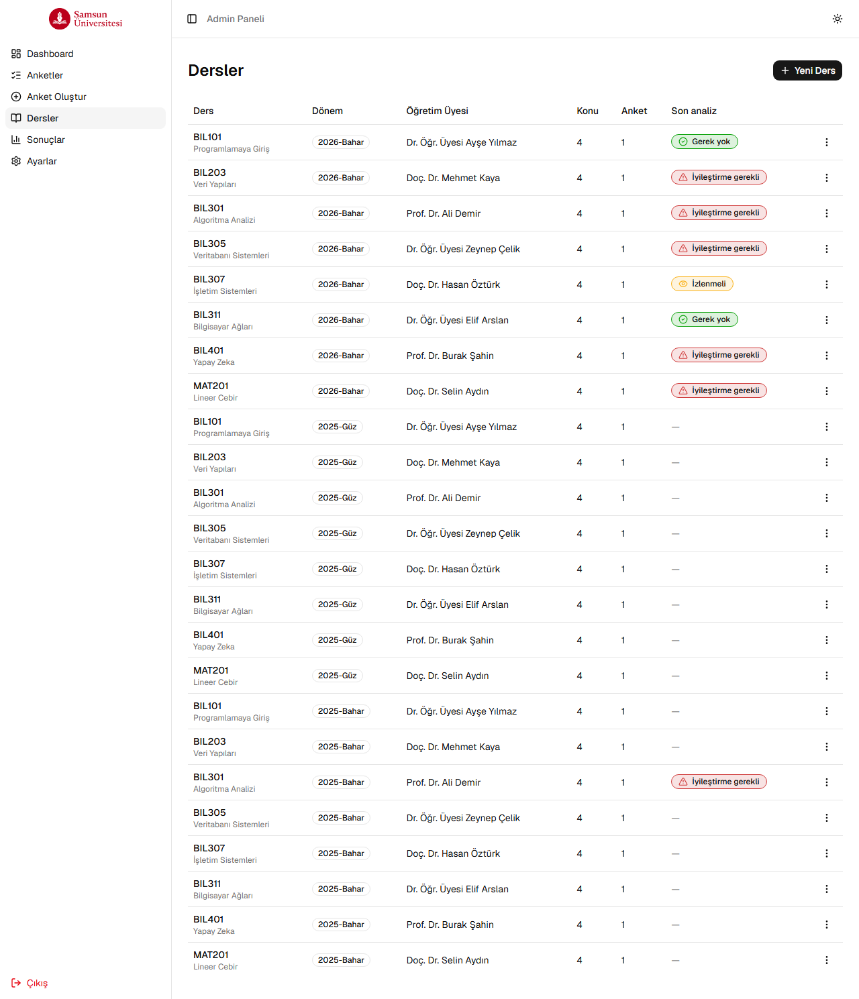
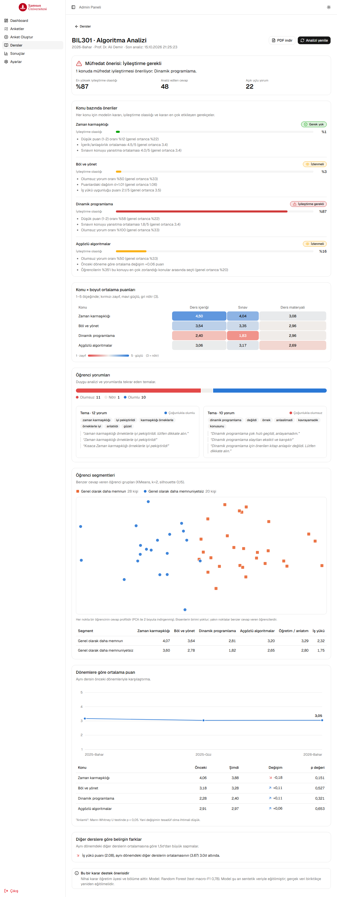
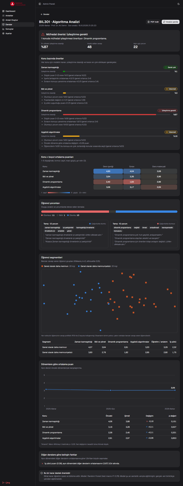

# Samsun Üniversitesi Anket Sistemi

Final sınavları sonrası öğrencilerden ders/sınav değerlendirme anketi toplayan, toplanan geri bildirimleri **makine öğrenmesiyle analiz edip ders müfredatı için gerekçeli iyileştirme önerisi** üreten web uygulaması. Adminler anket oluşturur, öğrenciler sadece `@samsun.edu.tr` uzantılı hesaplarıyla giriş yapıp anketleri cevaplar.

> BTK Akademi kursu bitirme projesi. Geliştirme sürecinde kursta öğrenilen Claude Code teknikleri (plan modu, spec-driven development, `CLAUDE.md`, skill'ler, MCP) kullanıldı. Ayrıntılar: [`docs/proje-raporu.md`](docs/proje-raporu.md), yol haritası: [`docs/plan.md`](docs/plan.md).

## Genel Mimari

Monorepo yapısında, birbirinden bağımsız üç proje:

```
samu-anket-web/
├── server/   # Express + MongoDB REST API
├── client/   # React + TypeScript SPA
└── ml/       # FastAPI + scikit-learn analiz servisi
```



İki farklı kimlik doğrulama akışı var:

- **Öğrenci**: [Clerk](https://clerk.com) üzerinden Google ile giriş. İlk girişte backend, Clerk'ten dönen e-posta `@samsun.edu.tr` ile bitmiyorsa hesabı reddeder.
- **Admin**: Klasik kullanıcı adı/şifre + JWT. Tek admin `scripts/seedAdmin.js` ile oluşturulur, sonrasında panelden şifre değiştirilebilir.

ML servisi dışarıya açık değildir. Sadece Node backend, paylaşılan bir token ile çağırır. Öğrencinin adı, e-postası ve kullanıcı kimliği bu servise hiç gönderilmez.

## Özellikler

### Öğrenci
- Google ile giriş (sadece samsun.edu.tr hesapları)
- O an aktif olan anketleri listeleme ve doldurma
- Anket süresi dolmadan önce kendi cevabını düzenleyebilme
- Geçmişte doldurduğu anketleri görüntüleme

### Admin
- Anket oluşturma / düzenleme / silme / kopyalama
- Dört soru tipi: metin, 1-5 puanlama, tek seçim, çoklu seçim (seçenek sayısı ve zorunluluk admin tarafından belirlenir)
- **Sınav tarihine göre otomatik zamanlama**: admin sadece sınav tarih/saatini girer. Anket sınavdan 10 dakika önce otomatik açılır, sınav gününün (TR saatiyle) 23:59'unda otomatik kapanır ve ertesi güne sarkmaz.
- Anket kaydetmeden önce öğrenci görünümünde canlı önizleme
- **Dersler ve müfredat konuları**: Anketler bir derse, sorular o dersin bir müfredat konusuna ve bir değerlendirme boyutuna (içerik, öğretim, materyal, sınav, iş yükü) bağlanır.
- Dashboard: toplam/aktif anket, toplam cevap, toplam öğrenci sayısı ve son anketler
- Sonuç sayfası: soru bazlı özet istatistik (ortalama, seçenek dağılımı)
- **Excel export**: öğrenci kimliği (ad/e-posta) anonimleştirilmiş cevap listesi + veri çubuklu (data bar) özet sayfası
- Şifre değiştirme

### Müfredat analizi (makine öğrenmesi)
Admin, bir dersin analiz sayfasında tek tıkla şunları alır:

| Analiz | Yöntem |
|---|---|
| **Konu bazında iyileştirme kararı**: "İyileştirme gerekli / İzlenmeli / Gerek yok", olasılık ve 3 gerekçeyle | RandomForest (LogisticRegression ile CV'de karşılaştırılıp seçildi), yerel pertürbasyon ile açıklama |
| **Yorum duygu analizi** (olumlu / nötr / olumsuz) | TF-IDF (kelime + karakter n-gram) + LogisticRegression; Türkçe karaktersiz yazımı da tanır |
| **Tekrar eden temalar**: anahtar kelimeler ve örnek yorumlar | TF-IDF + NMF |
| **Öğrenci segmentleri**: "'Dinamik programlama' konusunda zorlananlar" gibi | KMeans (k silhouette ile seçilir) + PCA |
| **Dönemler arası trend** ve anlamlılık | Mann-Whitney U testi |
| **Diğer derslere göre sapma** | z-skor |

- Konu × boyut ısı haritası, segment dağılım grafiği, trend grafiği, PDF rapor
- Analiz sonuçları saklanır; yeni cevap gelince "analiz güncel değil" uyarısı çıkar
- **KVKK**: 5'ten az cevabı olan derste analiz yapılmaz ve gösterilmez
- Kararlar bir **öneridir**; nihai karar öğretim üyesi ve bölüme aittir

Model sonuçları (sentetik veride): karar modeli test macro-F1 **0,78**; duygu analizi, şablon dışı elle yazılmış yorumlarda **%73**. Ayrıntı: [`ml/reports/model_raporu.md`](ml/reports/model_raporu.md).

### Güvenlik
- Admin girişinde rate limiting, timing-safe şifre karşılaştırması
- Genel API rate limiting, `helmet`, `CORS` allowlist
- NoSQL injection ve mass-assignment koruması (izinli alan listeleri, tip kontrolleri)
- Anket silinince ilişkili cevaplar da transaction içinde silinir (yetim kayıt kalmaz)
- Öğrenci sadece aktif/kendi zaman penceresindeki anketleri görebilir, cevap düzenlerken sahiplik kontrolü yapılır
- ML servisi `X-ML-Token` ile korunur (sabit süreli karşılaştırma). Öğrenciler ML'e yalnızca HMAC ile tek yönlü özetlenmiş kimlikle gider.

## Ekran Görüntüleri

**Öğrenci giriş sayfası**


**Giriş sonrası anket listesi**


**Admin panel görünümü**


**Anket sonuçları (koyu tema)**


**Dersler: son analiz kararları**


**Müfredat analizi (açık tema)**


**Müfredat analizi (koyu tema)**


> Analiz ekran görüntülerindeki dersler, öğretim üyeleri ve cevaplar sentetik demo verisidir.

## Teknoloji

**Backend**: Node.js, Express 5, MongoDB + Mongoose, Clerk (`@clerk/express`), JWT, bcryptjs, `express-rate-limit`, `helmet`, `exceljs`.

**Frontend**: React 19, TypeScript, Vite, Tailwind CSS v4, shadcn/ui (Base UI tabanlı), React Router, TanStack Query, Axios, `@clerk/clerk-react`, `next-themes` (açık/koyu/sistem tema), Sonner (toast), `jspdf` + `html2canvas-pro`.

**ML servisi**: Python 3.12, FastAPI, scikit-learn, pandas, NumPy, SciPy, joblib, pytest.

## Kurulum

Ön koşullar: Node.js 22+, Python 3.12, bir MongoDB (Atlas önerilir, anket silme işlemi transaction kullandığı için replica set gerekir).

### 1. Backend (`server/`)

```bash
cd server
npm install
```

`server/.env` dosyası oluşturun:

```
PORT=5000
MONGO_URI=mongodb+srv://...
ADMIN_USERNAME=...
ADMIN_PASSWORD=...
JWT_SECRET=...
CLERK_SECRET_KEY=...
CLERK_PUBLISHABLE_KEY=...
CLIENT_URL=http://localhost:5173
# ML analiz servisi (opsiyonel; yoksa sadece analiz özelliği kapalı olur)
ML_SERVICE_URL=http://localhost:8000
ML_SERVICE_TOKEN=uzun-rastgele-bir-deger
# Sadece gerçek bir reverse proxy (Render/Railway/nginx) arkasında deploy edilince:
# TRUST_PROXY=1
```

İlk admin kullanıcısını oluşturun (bir kereye mahsus):

```bash
npm run seed
```

Sunucuyu başlatın:

```bash
npm run dev     # nodemon ile
npm start       # production
```

### 2. Frontend (`client/`)

```bash
cd client
npm install
```

`client/.env` dosyası oluşturun:

```
VITE_API_URL=http://localhost:5000/api
VITE_CLERK_PUBLISHABLE_KEY=pk_...
```

> `VITE_CLERK_PUBLISHABLE_KEY` backend'deki `CLERK_PUBLISHABLE_KEY` ile aynı olmalı (public key, gizli değil).

```bash
npm run dev       # http://localhost:5173
npm run build     # production build
```

### 3. ML servisi (`ml/`)

```bash
cd ml
py -3.12 -m venv .venv
.venv\Scripts\python -m pip install -r requirements.txt
```

`ml/.env` dosyası oluşturun (`ml/.env.example`). Token, `server/.env` içindeki `ML_SERVICE_TOKEN` ile **aynı** olmalı:

```
ML_SERVICE_TOKEN=uzun-rastgele-bir-deger
```

Sentetik veriyi üretin, modelleri eğitin ve servisi başlatın:

```bash
.venv\Scripts\python data/generate_synthetic.py --seed 42
.venv\Scripts\python -m app.train      # models/ + reports/model_raporu.md
.venv\Scripts\python -m uvicorn app.main:app --reload --port 8000
.venv\Scripts\python -m pytest -q      # testler
```

### 4. Demo verisi (opsiyonel)

Gerçek öğrenci verisi olmadan analizi denemek için sentetik demo verisini veritabanına yükleyin. 8 ders × 3 dönem, 400 öğrenci yüklenir. Kayıtlar `isDemo: true` ile işaretlenir; gerçek kayıtlara dokunulmaz.

```bash
cd server
npm run seed-demo              # demo verisini yükle (tekrar çalıştırılabilir)
npm run seed-demo -- --clean   # sadece demo verisini sil
```

### Tek tıkla çalıştırma

Kurulumdan sonra kök dizindeki **`start.bat`** server, client ve ML servisini ayrı terminallerde açar. ML modeli henüz eğitilmemişse önce eğitir.

### Clerk Dashboard ayarları

- **Configure → SSO Connections**: Google bağlantısı etkin olmalı.
- **Configure → Restrictions**: Sign-up modu açık (Public) olmalı. Domain filtresi Clerk'te değil, uygulama kodunda yapılıyor (`@samsun.edu.tr` kontrolü hem backend hem frontend'de).

## Klasör Yapısı

```
server/
├── config/db.js               # MongoDB bağlantısı
├── controllers/               # İş mantığı (auth, admin, survey, response, course, analysis)
├── middlewares/auth.js        # requireAdmin / requireAuth (Clerk)
├── models/                    # User, Survey, Response, Course, AnalysisReport (Mongoose)
├── routes/                    # Express router'ları
├── services/                  # analysisPayload (anonim ML verisi), mlClient
├── scripts/                   # seedAdmin, seedDemoData, backfillSurveySlugs
├── utils/                     # surveySchedule (examDate → açılış/kapanış), slug
└── index.js                   # App giriş noktası, güvenlik middleware'leri

client/src/
├── components/
│   ├── layout/                 # StudentLayout, AdminLayout (sidebar'lı)
│   ├── ui/                     # shadcn bileşenleri
│   ├── admin/                  # SurveyPreviewDialog, QuestionBarChart
│   └── analysis/               # Karar rozeti, ısı haritası, segment ve trend grafikleri
├── hooks/useStudentApi.ts      # Clerk token'lı axios instance
├── lib/                        # api, pdf, analysis (renk/etiket), course
├── pages/
│   ├── student/                # Giriş, anket listesi, cevaplama, geçmiş cevaplar
│   └── admin/                  # Login, dashboard, anket CRUD, dersler, analiz, sonuçlar, ayarlar
├── routes/                     # RequireStudent/RequireAdmin route guard'ları
└── types/                      # Paylaşılan TypeScript tipleri

ml/
├── app/
│   ├── main.py                 # FastAPI: /health, /analyze, /train
│   ├── analyze.py              # Analiz orkestrasyonu
│   ├── train.py                # Model eğitimi + rapor
│   └── pipeline/               # preprocess, features, builder, sentiment, themes, segments, decision, trend
├── data/generate_synthetic.py  # Sentetik veri üretici
├── reports/model_raporu.md     # Model karşılaştırma ve değerlendirme raporu
└── tests/                      # pytest

docs/
├── plan.md                     # Yol haritası (faz 0-6)
├── specs/                      # Her faz için spec ve kabul kriterleri
└── proje-raporu.md             # Bitirme projesi raporu
```

## API Uçları (özet)

| Yöntem | Yol | Kim | Açıklama |
| --- | --- | --- | --- |
| POST | `/api/admin/login` | herkes | Admin girişi |
| PUT | `/api/admin/password` | admin | Şifre değiştirme |
| GET | `/api/admin/stats` | admin | Dashboard istatistikleri |
| GET | `/api/surveys/active` | öğrenci | Aktif anketler |
| GET | `/api/surveys/student/:slug` | öğrenci | Tek anket (sadece aktifse) |
| GET/POST/PUT/DELETE | `/api/surveys` | admin | Anket CRUD |
| GET/POST/PUT/DELETE | `/api/courses` | admin | Ders ve müfredat konuları CRUD |
| POST | `/api/responses` | öğrenci | Cevap gönder |
| PUT | `/api/responses/:id` | öğrenci | Kendi cevabını güncelle |
| GET | `/api/responses/my` | öğrenci | Geçmiş cevaplarım |
| GET | `/api/responses/survey/:surveyId` | admin | Anket sonuçları |
| GET | `/api/responses/survey/:surveyId/export` | admin | Excel export |
| GET | `/api/analysis/courses/:courseId` | admin | Kayıtlı son analiz (güncellik bilgisiyle) |
| POST | `/api/analysis/courses/:courseId` | admin | Analizi çalıştır ve kaydet |
| GET | `/api/analysis/summary` | admin | Derslerin son kararları |

## Notlar

- `@samsun.edu.tr` domain kısıtlaması, savunma derinliği için hem backend (`middlewares/auth.js`) hem frontend'de (`routes/RequireStudent.tsx`) ayrı ayrı uygulanıyor.
- Sınav saati hesaplamaları Türkiye saat dilimini (UTC+3, DST yok) sabit varsayar; frontend'den gönderilen `examDate` bu yüzden her zaman `+03:00` ofsetiyle gönderilir.
- **ML modelleri şu an sentetik veriyle eğitilmiştir.** Gerçek öğrenci verisi biriktikçe `POST /train` ile yeniden eğitilecek şekilde tasarlandı, ancak gerçek veride henüz doğrulanmadı.
- Production'a çıkmadan önce gözden geçirilmesi gerekenler: `CLIENT_URL` gerçek domain ile ayarlanmalı, IP başına rate limit (kampüs ağı gibi paylaşımlı IP'ler için) tekrar değerlendirilmeli.
