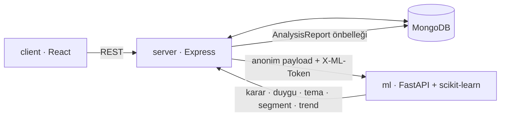

# Bitirme Projesi Raporu: Veriye Dayalı Müfredat İyileştirme Platformu

**Proje:** Samsun Üniversitesi Anket Sistemi + Müfredat Analizi
**Kurs:** BTK Akademi, Claude Code ile yazılım geliştirme
**Hazırlayan:** Eray Çubukçu
**Tarih:** Ekim 2026
**Kod:** `btk-egitim` branch'i

---

## 1. Özet

Mevcut bir ders değerlendirme anketi sistemi, toplanan öğrenci geri bildirimlerini işleyerek **"Bu dersin müfredatında iyileştirme yapılmalı mı, yapılmalıysa hangi konularda?"** sorusuna gerekçeli cevap veren bir karar destek platformuna dönüştürüldü.

Sisteme üç ana parça eklendi:
1. **Ders ve müfredat konusu modeli:** Anketler derse, sorular konu ve değerlendirme boyutuna bağlandı.
2. **Python ML servisi:** Konu bazında iyileştirme kararı, Türkçe yorum duygu analizi, tema çıkarımı, öğrenci segmentasyonu, dönemler arası trend ve anomali tespiti yapıyor.
3. **Admin analiz ekranı:** Sonuçlar grafikler ve PDF raporla sunuluyor.

Gerçek veri olmadığı için deterministik bir sentetik veri üreticisi yazıldı.

| Ölçüt | Sonuç |
|---|---|
| Karar modeli (test seti, 3 sınıf) | macro-F1 **0,78**, doğruluk **%80,6** |
| Bilerek sorunlu bırakılan 5 konunun tespiti | **5 / 5** |
| Duygu analizi, şablon dışı elle yazılmış yorumlar | **%73,3** doğruluk |
| ML test paketi | 18 / 18 test geçti |
| Kod değişikliği (`main..btk-egitim`) | 71 dosya, ~5.300 satır ekleme |

---

## 2. Problem ve Hedef

Proje öncesindeki sistem:
- Anketleri tek tek, soru bazında özetliyordu (ortalama, seçenek dağılımı).
- Anketin hangi derse, döneme veya müfredat konusuna ait olduğunu bilmiyordu.
- Açık uçlu yorumları sadece listeliyordu.
- "Ne değiştirmeliyiz?" sorusuna cevap vermiyordu.

Hedef: Bölüm ve öğretim üyesine, öğrenci geri bildirimine dayanan, **açıklanabilir** ve **gizliliğe saygılı** bir müfredat önerisi sunmak. Sistem bir **öneri** üretir; nihai karar öğretim üyesi ve bölüme aittir. Bu not arayüzde de gösterilir.

---

## 3. Sistem Mimarisi

**Veri modeli eklemeleri**
- `Course`: kod, ad, bölüm, dönem, öğretim üyesi, müfredat konuları. `(kod, dönem)` benzersiz.
- `Survey.course` ve soru başına `topic` (dersin konularından biri) ile `dimension` (içerik, öğretim, materyal, sınav, iş yükü).
- `AnalysisReport`: Ders başına son analiz. Veri değişince "güncel değil" olarak işaretlenir.

**Analiz akışı**
1. Admin "Analizi çalıştır" der.
2. Node; dersin anketlerini, aynı dersin önceki dönemlerini (sınav tarihine göre sıralı) ve aynı dönemdeki diğer derslerin boyut ortalamalarını toplar.
3. Öğrenci kimliği `HMAC(userId)` ile tek yönlü özetlenir; ad, e-posta ve kullanıcı kimliği gönderilmez.
4. ML servisi analiz eder, Node sonucu saklar, arayüz gösterir.

---

## 4. Makine Öğrenmesi

### 4.1 Karar modeli: müfredat iyileştirme
- **Birim:** ders × dönem × müfredat konusu.
- **Sınıflar:** iyileştirme gerekli / izlenmeli / gerek yok.
- **Özellikler (12):** boyut bazında ortalamalar (içerik, sınav, materyal, anlatım, iş yükü), puan dağılımı (σ), düşük puan oranı, olumsuz yorum oranı, "en çok zorlanılan konu" seçilme oranı, sınav zorluk algısı, önceki döneme göre değişim, cevap sayısı.
- **Model seçimi:** RandomForest ve LogisticRegression, eğitim setinde 5 katlı CV ile macro-F1'e göre karşılaştırıldı. RandomForest (0,790 ± 0,013) LogisticRegression'dan (0,771 ± 0,015) iyi çıktı ve seçildi.
- **Açıklanabilirlik:** Her karar için yerel pertürbasyon uygulanır: her özellik eğitim ortancasıyla değiştirilir, olasılıktaki düşüş o özelliğin katkısı sayılır. En etkili 3 özellik Türkçe gerekçe metnine çevrilir. Örnek: *"Öğrencilerin %88'i bu konuyu en çok zorlandığı konular arasında seçti (genel ortanca %19)"*.

**Test seti sonuçları (360 satır)**

| | Precision | Recall | F1 |
|---|---|---|---|
| İyileştirme gerekli | 0,82 | 0,89 | 0,85 |
| İzlenmeli | 0,69 | 0,53 | 0,60 |
| Gerek yok | 0,85 | 0,91 | 0,88 |

"İzlenmeli" en zor sınıf: iki uç sınıfın arasında kalıyor. Bu beklenen bir sonuç, çünkü sınır vakaları temsil ediyor. En önemli özellik düşük puan oranı; onu materyal ve sınav ortalamaları izliyor.

### 4.2 Türkçe yorum analizi (klasik NLP)
- **Duygu:** TF-IDF (kelime 1–2 gram + karakter 2–5 gram) + LogisticRegression. Karakter n-gram'ları Türkçe eklerini ("-madı", "-siz") yakalıyor. Türkçe karakterler ASCII'ye katlanıyor, böylece "anlaşılmadı" ve "anlasilmadi" aynı ifade sayılıyor.
- **Tema:** TF-IDF + NMF. Kökler okunabilir kelimelere geri eşleniyor, tekrar eden anahtar kelimeler birleştiriliyor.
- **Yorum → konu eşlemesi:** Yorumda adı geçen müfredat konusu (Türkçe karakter ve büyük/küçük harf farkı yok sayılarak).

### 4.3 Segmentasyon, trend, anomali
- **Segmentasyon:** KMeans (k = 2–3, silhouette ile seçilir) + PCA. Segment adları hem göreli farka hem mutlak puana bakılarak otomatik veriliyor.
- **Trend:** Aynı konunun önceki dönemle karşılaştırması, Mann-Whitney U testi (p < 0,05).
- **Anomali:** Aynı dönemdeki diğer derslerin boyut ortalamalarına göre z-skor (|z| ≥ 1,5).

### 4.4 Sentetik veri
`ml/data/generate_synthetic.py --seed 42` deterministik olarak şunları üretir:
- **Demo:** 8 ders × 3 dönem, 400 öğrenci, ~1.000 cevap.
- **Karar eğitimi:** 1.800 satır.
- **Duygu eğitimi:** ~3.500 etiketli yorum.

Simülasyon her konu ve boyut için **gizli (latent) bir kalite** tanımlar. Öğrenci puanları bu kaliteden gürültüyle üretilir. **Etiketler gözlenen puanlardan değil, gizli kaliteden** (%8 etiket gürültüsüyle) hesaplanır. Böylece model kuralı ezberleyemez: gözlenen, gürültülü veriden gizli durumu tahmin etmek zorundadır.

---

## 5. Kursta Öğrenilenlerin Projede Kullanımı

| Kurs konusu | Projede nasıl kullanıldı |
|---|---|
| **Plan modu → plan.md** | İş, plan modunda başladı. Kurs notları ve kod incelenip [`docs/plan.md`](plan.md) yol haritası çıkarıldı ve onaylandıktan sonra uygulandı. |
| **/init → CLAUDE.md** | Proje taranarak `CLAUDE.md` oluşturuldu ve her fazda yeni mimari bilgiyle güncellendi (Course modeli, ML akışı, PDF tuzakları vb.). |
| **Spec-driven development** | Her faz koddan önce [`docs/specs/`](specs/) altında gereksinim ve kabul kriterleriyle yazıldı. Faz 3'te `/analyze` JSON sözleşmesi önceden sabitlendi; Faz 4 (Node) ve Faz 5 (arayüz) bu sözleşmeye göre yazıldı. |
| **Fonksiyonel / fonksiyonel olmayan gereksinimler** | Bkz. §6. Performans, KVKK, servis güvenliği ve tek komutla çalıştırma fonksiyonel olmayan gereksinim olarak ele alındı. |
| **Skill** | Tekrar eden "veri üret → DB'ye yükle" işi proje skill'ine dönüştürüldü (`.claude/skills/demo-veri-yenile`). Grafikler yazılmadan önce `dataviz` skill'i yüklendi ve renk paleti skill'in doğrulama script'iyle test edildi. |
| **İterasyon, AI çıktısını doğrulamak** | Her faz gerçek çalıştırmayla doğrulandı: API senaryoları, pytest, ekran görüntüsü alıp inceleme. Bu sayede testlerin yakalamadığı sorunlar bulundu (§7). |
| **bat dosyası** | `start.bat`, üç servisi ayrı terminallerde açıyor ve ML modeli yoksa önce eğitiyor (kurs notundaki örneğin uygulaması). |
| **/rename, /context, /resume** | Oturum `samu-anket-websitesi` olarak adlandırıldı; bağlam kullanımı `/context` ile izlendi. |
| **Git iş akışı** | Tüm çalışma `btk-egitim` branch'inde, faz başına ayrı commit'lerle yürütüldü. `main` dokunulmadan kaldı. |

**Kullanılmayanlar (bilinçli olarak):**
- **Vercel MCP ile canlıya alma:** MCP bağlı, ancak deploy bu aşamada kapsam dışı bırakıldı. Demo yerelde yapılıyor (bkz. §9).
- **Subagent / agent teams:** İş tek oturumda sıralı fazlarla yürütüldü. Fazlar birbirinin çıktısına bağımlıydı; paralelleştirmenin kazancı düşüktü.
- **CronCreate / zamanlanmış görevler:** "Her dönem sonu modeli yeniden eğit" senaryosu için uygun ama gerçek veri olmadan anlamlı değil.

---

## 6. Gereksinimler ve Durum

| Fonksiyonel | Durum |
|---|---|
| Ders ve müfredat konusu yönetimi | ✅ |
| Ders × konu bazında gerekçeli iyileştirme kararı | ✅ |
| Yorum duygu ve tema analizi | ✅ |
| Öğrenci segmentasyonu, trend ve anomali | ✅ |
| Müfredat iyileştirme raporu (PDF) | ✅ |

| Fonksiyonel olmayan | Durum |
|---|---|
| KVKK: anonimleştirme, 5 cevap eşiği | ✅ Payload'da 400 demo öğrencinin hiçbir kimlik bilgisi geçmediği otomatik olarak doğrulandı |
| Servisler arası token doğrulaması | ✅ Eksik/yanlış token 401; Node bunu 502 olarak raporluyor |
| ML servisi kapalıyken sistemin çalışmaya devam etmesi | ✅ Sadece analiz 503 dönüyor, kayıtlı raporlar okunabiliyor |
| Model sürümleme ve eğitim tarihinin kaydı | ✅ `models/metrics.json`, raporda sürüm bilgisi |
| Tek komutla çalıştırma | ✅ `start.bat` |
| Erişilebilirlik (renk körlüğü, koyu tema) | ✅ Durum renkleri ikon ve etiketle; palet doğrulandı; koyu tema ayrı tanımlı |
| Analiz süresi < 5 sn | ⚠️ ML tarafı ~0,2 sn. Geliştirme ortamındaki yavaş veritabanı bağlantısında uçtan uca 3–25 sn ölçüldü; normal bağlantıda ölçülmedi. |

---

## 7. Karşılaşılan Sorunlar ve Çözümler

| Sorun | Nasıl bulundu | Çözüm |
|---|---|---|
| Analiz 79 saniye sürüyordu | Uçtan uca testte süre ölçüldü; adımlar tek tek profillendi | Darboğaz ML değil, karşılaştırma için tüm derslerin cevaplarını Node'a çekmekti. Hesap MongoDB aggregation'a taşındı (sonuç Python'daki bağımsız hesapla birebir doğrulandı); bu ortamda 79 sn → 3–25 sn. |
| Demo yorumlarının hepsi önce olumsuz, sonra hepsi olumlu çıktı | Analiz çıktısı okunarak | Üretici, öğrencinin en çok şikâyet ettiği veya beğendiği şey hakkında, şikâyet 2 kat ağırlıklı olacak şekilde yorum yazacak biçimde yeniden tasarlandı. |
| Segment "memnun" diye adlandırılıyordu ama puanı 2,8'di | Ekran görüntüsü incelenerek | Adlandırma göreli farkın yanında mutlak puana da bakıyor. |
| PDF'te başlık görünmüyor, kartlarda gri şeritler var | PDF'e giren görüntü ayrıca üretilip incelendi | html2canvas, `box-shadow`'u hatalı çiziyordu; PDF modunda gölgeler kapatıldı. Mevcut sonuç sayfasının PDF'i de aynı ortak koda bağlandığı için düzeltmeden yararlanıyor. |
| Dördüncü segment rengi renk körlüğü testinden geçmedi | dataviz doğrulama script'i | Segment sayısı en fazla 3 ile sınırlandı; renge ek olarak nokta şekli kullanıldı. |
| Gerekçede "Cevap sayısı 49" görünüyordu | Çıktı okunarak | Modelde kullanılan ama gerekçe olarak anlamsız özellikler açıklamadan çıkarıldı. |

---

## 8. Sınırlılıklar ve Dürüstlük Notları

1. **Modeller sentetik veriyle eğitildi.** Skorlar, modelin gözlenen gürültülü veriden simülasyondaki gizli durumu ne kadar iyi tahmin ettiğini gösterir; gerçek öğrenci verisindeki başarıyı göstermez. Sistem gerçek veri geldikçe `POST /train` ile yeniden eğitilecek şekilde tasarlandı.
2. **Duygu analizi** sentetik testte %100 ama bu yapay: test yorumları eğitimdeki şablonlardan üretildi. Şablon dışı elle yazılmış 15 yorumda %73. Yanlışlar özellikle olumsuz kelime içeren olumlu cümlelerde ("çalışan herkes geçebilirdi") ve nötr yorumlarda.
3. **"Katılım oranı" özelliği** planlandı ama kullanılamadı, çünkü sistemde derse kayıtlı öğrenci sayısı tutulmuyor.
4. **Yorum → konu eşlemesi** konu adının yorumda geçmesine dayanıyor; "DP" gibi kısaltmaları yakalamıyor.
5. Karar bir **öneridir**; arayüzde de belirtildiği gibi nihai karar öğretim üyesi ve bölüme aittir.

---

## 9. Gelecek Çalışmalar

- **Canlıya alma:** Frontend Vercel'e, backend ve ML servisi Render'a. Gerekli ayarlar: Atlas IP izinleri ve Clerk izinli origin listesi.
- **Gerçek veri:** Bir dönem gerçek anket verisiyle modeli yeniden eğitmek ve sonuçları öğretim üyeleriyle birlikte değerlendirmek.
- **Derse kayıtlı öğrenci sayısı:** Katılım oranı özelliğini geri eklemek.
- **Zamanlanmış görev:** Dönem sonlarında otomatik yeniden eğitim ve analiz.
- **Duygu analizi:** Gerçek yorumlarla etiketli küçük bir veri seti oluşturup modeli iyileştirmek.

---

## Ek: Commit Geçmişi (`btk-egitim`)

| Faz | Commit | İçerik |
|---|---|---|
| — | `c440ca5` | CLAUDE.md |
| 0 | `9a35a1a`, `fa0290a` | Yol haritası, spec klasörü, start.bat |
| 1 | `21a3c72` | Ders, müfredat konusu, soru boyutu |
| 2 | `cccf831` | Sentetik veri üretici, demo seed |
| 3 | `46908cc` | ML servisi |
| 4 | `909a17b` | Node ↔ ML entegrasyonu |
| 5 | `62d1a8e` | Admin analiz ekranı |
| 6 | — | README, bu rapor, sunum |
